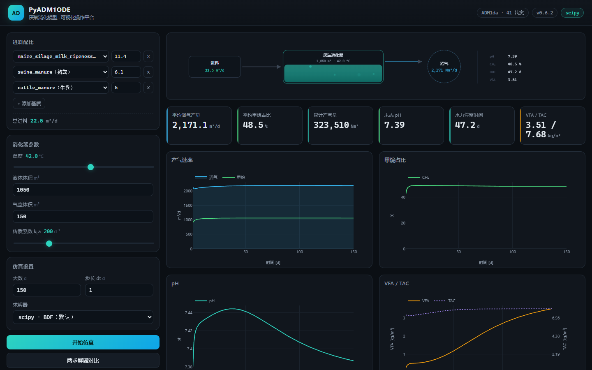
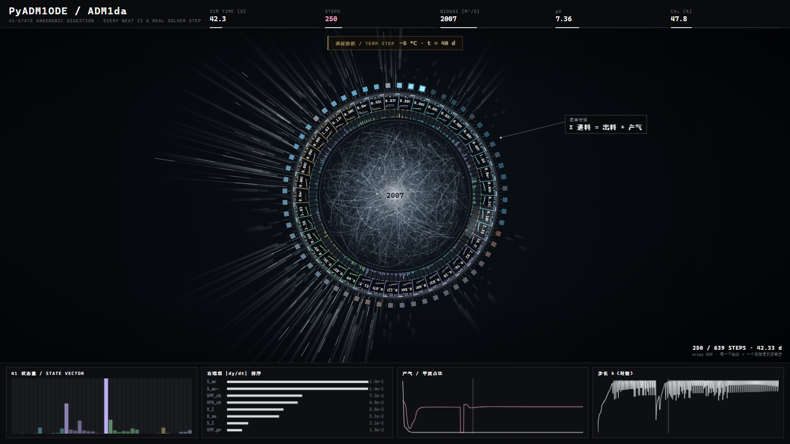
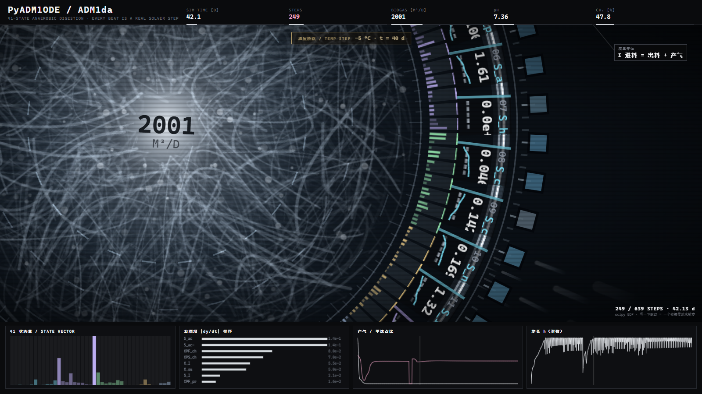
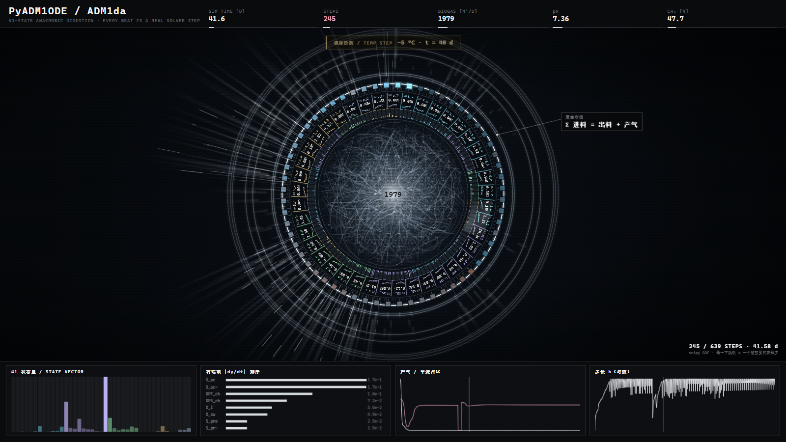
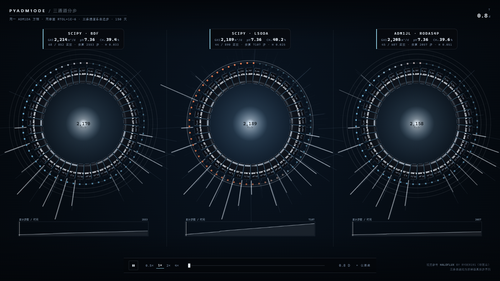
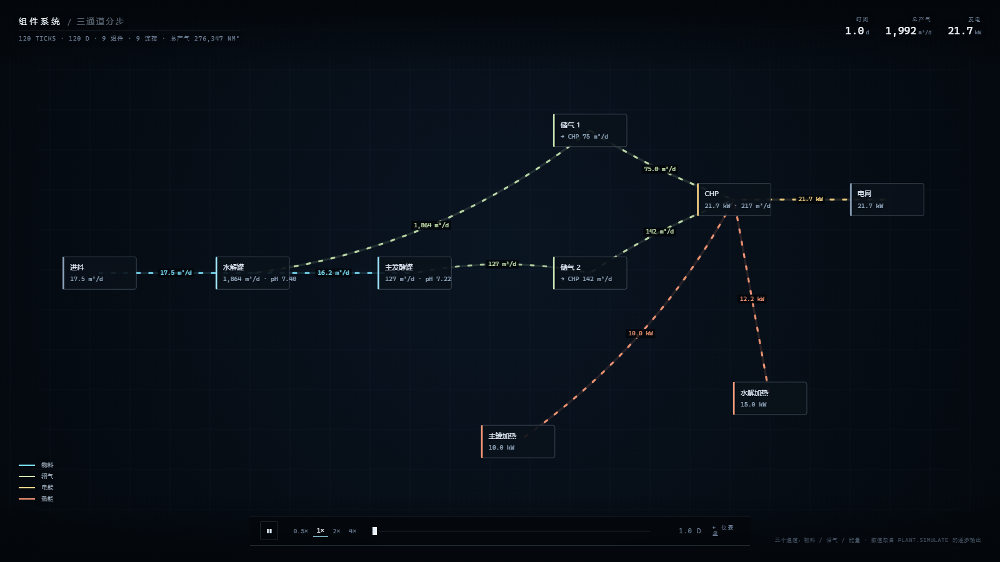
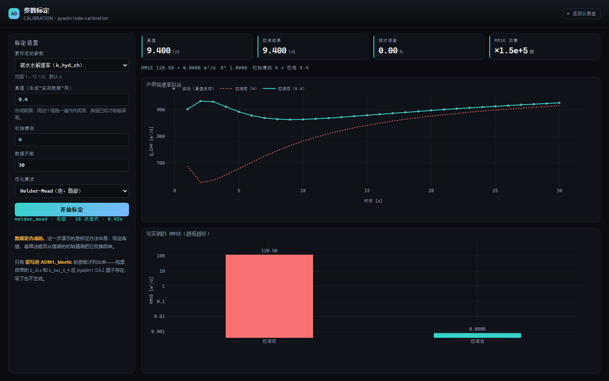
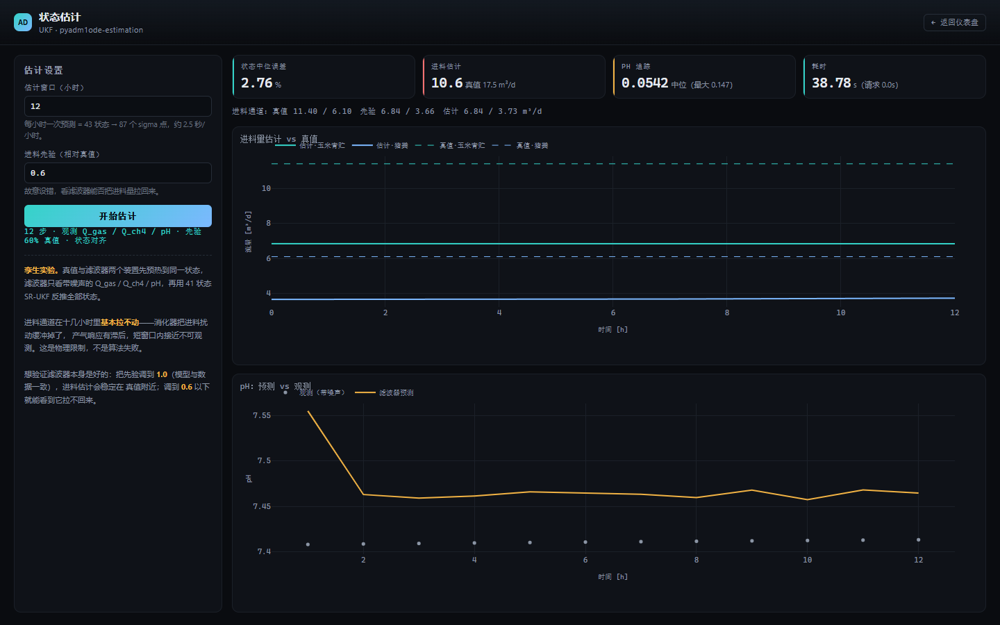

# PyADM1ODE 可视化操作平台（Demo）

一个跑在本机的单页仪表盘：左侧调工艺与进料，右侧看产气、pH、VFA/TAC 曲线，
一键切换求解器、导出 CSV。



## 启动

```powershell
# 在仓库根目录
.venv\Scripts\python.exe webdemo\app.py
```

浏览器打开 <http://127.0.0.1:8848>。

换端口：`.venv\Scripts\python.exe webdemo\app.py --port 9000`。
或者双击 `先复刻\pyadm1-web.bat`。

首次启动会 import numpy / scipy / pyadm1，约 1–2 秒；页面一打开就自动跑一遍默认工况
（150 天，约 1 秒）。

## 界面

**左栏**

| 区块 | 内容 |
| --- | --- |
| 进料配比 | 任意条数，基质从 `data/substrates/` 的 13 种里选，可加可删 |
| 消化器参数 | 温度、液体体积、气室体积、传质系数 k<sub>L</sub>a |
| 仿真设置 | 天数、步长 dt、求解器（scipy BDF / ADM1jl Rodas4P） |
| 按钮 | 开始仿真、两求解器对比、恢复默认 |
| 状态条 | 运行中 / 完成 / 失败，带耗时与时间点数 |

**右栏**

- 顶部工艺示意图：进料 → 消化器 → 沼气，并实时显示 pH / CH₄ / HRT / VFA
- 6 张指标卡：平均沼气、甲烷占比、累计产气、末态 pH、HRT、VFA/TAC
- 4 张曲线：产气速率、甲烷占比、pH、VFA/TAC（双轴）
- 底部：本次运行元信息 + 导出 CSV

**两求解器对比**会把同一工况分别用 scipy BDF 和 ADM1jl/Rodas4P 跑一遍，给出耗时、
加速比、以及三条曲线（沼气/甲烷/pH）的最大相对偏差。

`http://127.0.0.1:8848/?compare=1` 会在页面加载后直接跑一次对比——演示时省一次点击。

## 求解引擎（/engine）— 自研复刻



<http://127.0.0.1:8848/engine>

视觉语言照着 [HALOFLUX](https://github.com/Ryder191/haloflux) 复刻：编织光场核心、
一圈微数据卡、多层向外光束、节拍时钟、自动运镜、辉光叠加。

**代码全部自己写**（`static/engine.js`，原生 Canvas、零依赖），没有引入或改写上游任何源码，
因此不受它 PolyForm Noncommercial 协议的约束，署名只作灵感来源标注。

改的只是**数据源**——画面里每个元素都由真实求解步驱动：

| 画面 | 数据来源 |
| --- | --- |
| 节拍（每一下跳动、卡片闪白） | **一个被接受的求解步** |
| 光场里的流光丝 | 沿编织细丝跑的光脉冲，**迸发频率跟着节拍**（即步频）变密 |
| 向外光束的长度与亮度 | **该角度对应状态的 \|dy/dt\|**（各自按 p95 归一化） |
| 回弹波 → **环形冲击波** | **每步一圈**：速度 ∝ 1/步长（越吃力飞得越快）、幅度 ∝ 该步的总 \|dy/dt\|。之前的"撞外缘反弹"是虚构的，已删除 |
| 顶部事件条 | **真实仿真事件**（温度阶跃等），在时间轴经过时弹出 |
| 圆环上 41 张微卡片 | 状态名、**真实数值**、**最近 15 步的历史条**、14 步火花线 |
| 外圈 60 个纯色状态灯 | **最近 60 个求解步的"心跳带"**：一个灯 = 一步，颜色按该步步长从冷到热（步长越小越红），顶部最新、逆时针是历史 |
| 内圈 120 块细纹瓦片 | 三条竖条是**该状态最近 3 步的量级**，按组着色 |
| 画布标注条 | 当前步的 **h** 与 **Σ\|dy/dt\|**（原来轮播的 5 条"校验项"是写死的文案，已删） |
| 中心数字 / 光晕强度 | 产气速率 |
| 顶部 5 个 KPI | 时间、步数、产气、pH、CH₄ |
| 底部 4 块图 | 41 状态量、\|dy/dt\| 排序、产气/CH₄ 曲线、步长曲线 |

所以画面越"炸"的地方，就是求解器越吃力的地方——温度阶跃那一段环会明显抖、光束会变密。

### 动效审计：什么在动，动的是什么

把整页的动效过了一遍，判据只有一条：**这个量能不能追溯到求解器的真实数值**。
追溯不到就删，或者换成能追溯的。

| 元素 | 驱动量 | 结论 |
| --- | --- | --- |
| 节拍、卡片闪白 | 一个被接受的求解步 | 保留 |
| 光束长/亮 | 该角度状态的 \|dy/dt\| | 保留 |
| 环形冲击波 | 该步的步长 + Σ\|dy/dt\| | 保留（重写） |
| 状态灯、卡片数值/历史条/瓦片 | 真实状态量 | 保留（重写） |
| 转环角度 | 停顿期间走过的步数 | 保留（重写） |
| KPI 数字 | 真实 | 保留 |
| KPI 进度条 | 原来除以写死的 2400 / 6.6–8.0 | **改成按本次运行的极值归一** |
| 画布标注条 | 原来轮播 5 条写死的"校验项" | **改成打印当前步真实 h 与 Σ\|dy/dt\|** |
| 核心呼吸 | 原来 `sin(t*2.4)`（挂钟） | **改成只在落步时脉冲** |
| 核心外 3 圈虚线 | 原来按挂钟转 | **改成跟 `B.rot`** |
| 光束冲刺虚线 | 原来 `t*(0.6+gain)`，gain 一变相位就跳 | **改成恒定速率时钟** |
| 编织光场、齿、内刻度 | 静态纹理 | 保留（纹理，不是读数） |
| 光丝、脉冲粒子 | 出现频率跟节拍，个体参数随机 | 保留（粒子，不是读数） |
| 产气/甲烷占比面板 | CH4 占比在 gas=0 时**无定义** | 原来算成 0（假跌到谷底），**现在断开** |

**教训**：这些问题的共同点是「不报错、画面在动、信息量为 0」。最严重的是标注条——
它显示「质量守恒 ✓」这种字样，却**从来没有计算过任何守恒量**，看上去像实时校验面板。
装饰可以留，**冒充结论不行**。

`?still=1` 冻结时钟（画面继续重绘，方便截图和现场讲解）；`&shot=N` 锁定第 N 个机位
（0–10，第 7 个是 3.8× 微距）；`&t=40` 把时钟跳到第 40 天（正好是温度阶跃那一刻）。

第三个参数是用来验证**事件条**的：时钟越过事件时刻时，顶部会弹出
`温度阶跃 / TEMP STEP −5 °C · t = 40 d`，同时触发一次冲击波和光丝迸发——
这不是装饰，是 `steptrace` 记录的真实事件。

**手动调时间**：底部有一条时间轴，拖动即可定位到任意一步。

| 操作 | 行为 |
| --- | --- |
| 拖动滑块 | 跳到该步：卡片、瓦片、状态灯、四块小图、顶部 KPI 全部立即重算 |
| 点 `❚❚` / `▶` | 暂停 / 继续自动播放 |
| `空格` | 同上 |
| `←` `→` | 单步后退 / 前进（会自动暂停） |

拖动即暂停，松开不会自己继续——这样你能停在意料之外的地方看细节。
时间轴按**步**定位而不是按天数，所以停下来的位置永远正好是某个被接受的求解步。



*3.8× 微距机位：卡片按 3 倍超采样渲染，推这么近仍然清晰。*

**镜头**：11 个机位循环**演一遍**（1× → 3.8× 推近，部分机位带 ±0.06 rad 滚转），
演完把视角交给用户：**滚轮缩放 · 拖拽平移 · 双击复位**。
不想等就把鼠标放上去滚一下或者按住拖一下——**任何交互立即结束运镜**，不用等它走完。
相机变换是一个带旋转的仿射矩阵，光束的泛光缓冲用同一套矩阵降采样，
否则推近时辉光会和主体错位。缩放是**以光标为锚点**的（反解相机变换保证光标下那一点不动）。

**转环**：不是匀速转，是**转—停—转**，而且**永远单向**。每次冲刺 0.14–0.27 s（缓入缓出），然后停 0.55–1.3 s。停顿时整环、光场、扫描高光
**一起定住**——它们共用同一个相位 `B.rot`，所以不会出现"环停了、光还在转"的脱节。

转动角度不是随机的：**角度 ∝ 这次停顿期间求解器走过的步数**（0.05–0.29 rad）。
也就是说环每"咔"一下，对应的是一段真实计算量——求解器越忙，转得越频繁、每次角度越小；
空闲时反而一次转得多、停得久。

每个求解步会轻微缩短下次停顿（有 0.3 s 下限，保证停顿仍然看得见）。

**环形冲击波**：每走一步发一圈，两个参数都取自那一步的真实数值——

| 属性 | 映射 | 实测（温度阶跃前后） |
| --- | --- | --- |
| 速度 | `380 + 900 × 难度`，难度 = `(log₁₀h_max − log₁₀h) / 量程` | 稳态 **686 px/s** → 阶跃后 **1154–1280 px/s** |
| 幅度 | `0.22 + 0.8 × 该步 Σ\|dy/dt\| / p95` | 稳态 0.22 → 阶跃后 0.30–0.35 |
| 寿命 | `0.55 + 0.35 × (1 − 难度)` | 越吃力越短促 |

所以**一串又密又快的亮环 = 求解器正在硬扛**；稳态时是稀疏、慢、暗的环。



*温度阶跃后的一串环（`?still=1&freeze=2200&shot=0&t=41` 定格）。*

两个坑（都踩过）：步长量程必须**以中位数为锚**（启动段的 1e-6 步长会把 7 个数量级
全塞进 0.02–0.06，映射等于常数）；幅度基准要用**逐步 Σ\|dy/dt\| 的 p95**，
不能用 41 个状态各自 p95 之和（那个基准几乎没有步能达到，幅度也被压平）。

实现要点：世界坐标用**单个矩阵**换算到设备像素（不走 save/restore 栈，避免状态泄漏）；
41 张卡片和 120 块瓦片预渲染到 3 倍离屏 canvas、每帧轮转重绘；光场位图 2 倍超采样；
**光束分两遍画**——细的 3 层直接画在主画布（全分辨率，否则 0.8px 的线放进半分辨率缓冲
就是一团糊），粗的 4 层才进缓冲做泛光，合成时以画布中心为基准缩放（从原点缩放会让辉光
整体平移 2.5%，镜头一动就"错位"）；窗口尺寸变化后卡片会整批重绘，否则圆环会先出现半圈空白。

## 三通道分步（/trace）



开 <http://127.0.0.1:8848/trace>。同一 ADM1da 方程、同一组容差，**三种积分器各跑一遍**，
三条通道共用一根时间轴，各自跳自己的步：

| 通道 | 算法 | 150 天实算步数 |
| --- | --- | --- |
| `scipy · BDF` | 变阶 BDF | 2553 |
| `scipy · LSODA` | 自动切换 Adams/BDF | 7107 |
| `ADM1jl · Rodas4P` | Rosenbrock | 2057 |

三者终值完全一致（沼气 2136.5 m³/d、pH 7.3271），但步数差 3.5 倍。每列下方那条
**累计步数曲线**就是重点：斜率越陡，说明这个求解器在这段时间里越费劲
（温度阶跃那一段，三条曲线都明显变陡）。

每列中间是 41 状态环：卡片上印**状态名 + 当前值 + 最近 5 步的 \|dy/dt\| 条**，
外圈 60 个灯按该步步长着色，再外面是**冲击波**（速度 ∝ 1/步长），中心数字 = 产气速率。
色块/亮度和 `/engine` 用的是同一套映射，所以两个页面对同一段瞬态的反应是一致的。

每列顶部是一张 KPI 卡（气体流量 / pH / CH₄ 占比 / 回放步数 / 步长），
和 `/engine` 的头部同一套版式；三条通道**各自独立**取值，方便并排比较收敛路径。

**为什么第三通道不是 torch**：torch 是**另一个导数实现**，不是一个独立的积分器。它走的是
同一个 BDF，步序列会和第一列几乎重合，还要装 2.5 GB。所以第三列换成 LSODA——真正不同的
算法，步行为差别肉眼可见。要真加 torch 通道只改一行。

**操作**：空格播放/暂停，底部拖时间轴、切 0.5–4×；`?t=42` 跳到第 42 天并停住。

视觉向 [HALOFLUX](https://github.com/Ryder191/haloflux) 靠拢：近单色白光、密集的微面板环带、
长条拖影光束、颗粒 + 扫描线 + 上下暗边、全大写宽字距的 HUD。构图照它来的，Canvas 代码全部
自己写，没有复制它的实现。

## 组件系统 / 三通道流动（/system）



开 <http://127.0.0.1:8848/system>。这一页画的是**模块化组件网络**，节点和连线都是
`PlantConfigurator` 真实搭出来的两级厂站：

```
进料 → 水解罐 → 主发酵罐 → 储气 1/2 → CHP → 电网 / 水解加热 / 主罐加热
```

连线按通道着色、按实际流量流动（对数映射，所以 20 kW 的热流也看得见走向）：

| 通道 | 走什么 | 单位 |
| --- | --- | --- |
| 物料 | 进料、罐间出流 | m³/d |
| 沼气 | 消化器 → 储气罐 → CHP | m³/d |
| 电能 / 热能 | CHP → 电网 / 加热器 | kW |

连线上标的是**该时刻的真实流量**，不是平均值。

两个需要说明的地方：

- **CHP 稳态只有 ~22 kW（额定 500）**。不是画错：储气罐按"上一步的消耗量"回馈供气，
  CHP 要多少罐才给多少，于是稳定在低负荷。这是库里的控制逻辑，我没改它。
- **储气罐显示"→ CHP 75 m³/d"而不是存量**：罐容 1000 m³ 而进气 2000 m³/d，
  它一天内灌满即泄，存量恒为 0，显示存量没有意义。

## 参数标定（/calibration）



<http://127.0.0.1:8848/calibration>

用 `pyadm1ode-calibration` 从"实测数据"里反演一个动力学参数。数据是**合成的**：用已知真值
跑一遍当实测，再让算法从错误的初始猜测反推——真值已知，所以能直接看误差。

实测（k_hyd_ch，30 天，Nelder-Mead）：**4.4 秒，真值 9.40 → 反推 9.40，相对误差 0.00%**，
RMSE 从 120.50 降到 0.0008 m³/d，R² = 1.0000。

页面左下角写明了**哪些参数能标**：只有真实存在于 `ADM1._kinetic` 里的才列出来。
包里自带的 `k_dis` 和 7 个 `k_dec_X_*` 在 pyadm1 0.6.2 里不存在，写进去只会落在
`_calibration_params`，仿真结果一点不变——这是最容易踩的坑，所以在 UI 里直接屏蔽掉。

## 状态估计（/estimation）



<http://127.0.0.1:8848/estimation>

用 `pyadm1ode-estimation` 的 41 状态 SR-UKF 做孪生实验：真值与滤波器两个装置预热到同一状态，
滤波器只看带噪声的 `Q_gas / Q_ch4 / pH`。

实测（12 小时）：**约 30 秒，状态中位误差 2.76%**，pH 预测中位偏差 0.054。

页面上如实写了两个反直觉的结果：

- **进料通道在十几小时里拉不动**（先验 6.84 → 估计 6.84，真值 11.4）。消化器把进料扰动
  缓冲掉了，产气响应有滞后，短窗口内这个通道接近不可观测。把先验调到 1.0（模型与数据一致）
  时进料估计精确到 11.396 / 6.097（真值 11.4 / 6.1），说明滤波器本身没问题。
- **pH 用中位数而不是最大值**：第一步的预测是离群值（偏差 0.147），用 max 会把结论带偏。

两个页面都和主服务共用一条求解线程（`_serial`），不会和 Julia 抢线程。
标定/估计强制走 scipy 后端，完全不碰 Julia。

## API

| 方法 | 路径 | 说明 |
| --- | --- | --- |
| GET | `/api/meta` | 版本、基质列表、默认参数（**不加载 Julia**，所以很快） |
| POST | `/api/simulate` | 跑一次仿真，返回时间序列 + 汇总 |
| POST | `/api/compare` | 两个求解器各跑一遍，返回耗时/加速比/偏差 |
| POST | `/api/trace` | 记录单个求解器每一步（含真实步长） |
| POST | `/api/traces` | 三条求解通道各记录一遍，供 `/trace` 并排回放 |
| GET | `/api/system` | 两级厂站仿真，返回图拓扑 + 每条连线逐时刻流量 |
| GET | `/api/lab/meta` | 可标定的参数列表（只含真正存在于 `ADM1._kinetic` 的） |
| POST | `/api/calibration` | 合成数据 → 反演一个动力学参数，返回前后拟合与 RMSE |
| POST | `/api/estimation` | 孪生实验 UKF，返回进料/pH 轨迹、NIS、状态误差 |
| GET | `/trace` | 三通道分步页面 |
| GET | `/system` | 组件系统页面 |
| GET | `/calibration` | 参数标定页面 |
| GET | `/estimation` | 状态估计页面 |
| GET | `/api/health` | 存活探针 |

请求体示例：

```json
{
  "backend": "scipy",
  "duration": 150, "dt": 1.0,
  "temperature_c": 42.0,
  "v_liq": 1050.0, "v_gas": 150.0, "k_l_a": 200.0,
  "feed": [
    {"substrate_id": "maize_silage_milk_ripeness", "q": 11.4},
    {"substrate_id": "swine_manure", "q": 6.1}
  ]
}
```

## 实现说明

- **后端只做计算，不做展示**：`app.py` 用 `PlantConfigurator` 建厂、`plant.simulate()`
  积分，返回纯 JSON；所有图表与交互在浏览器里。
- **plotly.js 是本地文件**（`static/plotly.min.js`，从 pip 的 `plotly` 包里取的），
  不走 CDN，断网也能开。
- **两个求解器在同一进程里跑**：用 `set_solver_backend_override()` 切换，
  而不是改环境变量，避免污染进程。
- `?compare=1` 的对比会**先预热 Julia 再计时**，否则首次编译的 6 秒会算进加速比里，
  显示成 0.05× 那种误导性数字。
- **`calc_gas` 对参数极敏感**：它是 `q = k_p·(P_wet − P_ext)` 的线性溢出律，而平衡点离
  `P_ext` 只有约 0.03 bar。所以派生量必须在"该步当时"的参数下计算——第一版放在循环外、
  温度还原之后才算，一个 0.03 bar 的错配就把 1996 m³/d 显示成了 373,580 m³/d。
  现在 `steptrace.observe()` 在每一步的参数仍然生效时计算，并由
  `test_trace.py` 对照标准仿真守着。

## 注意

- 服务是单进程同步执行，一次只能跑一个仿真；点按钮后请等状态条变成"完成"。
- 选了 ADM1jl 后端时，**该进程的第一次**仿真要编译 Julia（约 6–10 秒），之后才快。
  对比模式里已经帮你预热了。
- **并发会死锁（已修）**：uvicorn 在线程池里跑同步端点，同时开 `/engine` 和 `/trace`
  （或加载中途刷新）会让两个请求同时进 Julia。`juliacall` 是内嵌运行时，跨线程并发调用会
  把它锁死——表现为端口还在听、进程 CPU 不再涨、连 `/api/health` 都不回。
  现在所有求解调用都提交到**单线程执行器**（`_serial()`），Julia 流量永远只有一条线程。
  `webdemo/concurrency_check.py` 就是复现这个场景的探针：同时打两个 `/api/traces`
  并轮询 health。

- **还有第二个更隐蔽的死锁入口（已修）**：`adm1_julia.available()` 内部会 `import
  juliacall`，也就是**会初始化 Julia 运行时**。`/api/compare` 原来在 `_serial` 之外先调了
  它——Julia 在 uvicorn 线程池的某个线程上初始化，真正的仿真随后在 worker 线程上调用，
  于是照样死锁。现在改为**进程启动时在 worker 线程里预加载一次**
  （`_WORKER.submit(_bootstrap_julia)`），`available()` 也移进了 `_serial`。

  附带好处：Julia 在启动时就装好，第一次点"两求解器对比"不再需要现场编译，
  并发时 health 也不会被饿死（实测 5 次探针全部 < 350 ms，此前最坏 7.5 秒超时）。
- **重算期间其他请求会变慢**：Python 的 GIL 决定了重计算时别的端点要排队
  （实测 health 偶发几百毫秒，最坏一次 7 秒），但不会僵死。重活上限 240 秒，
  超时返回 504 而不是无限等待。
- 这只是 demo：没有用户系统、没有数据库、没有任务队列。要做多人/批量，得把仿真
  挪到队列 + 独立进程里跑。
