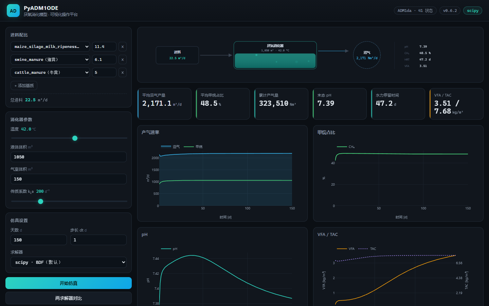

# PyADM1ODE 改进版 · Julia 加速求解 + 可视化平台

在 [PyADM1ODE](https://github.com/dgaida/PyADM1ODE)（ADM1da 厌氧消化 41 状态模型，MIT）之上做的一层
**工程化改进**：把数值求解换到 Julia、把三个包接成一个能点的网页平台，并把"参数筛选"这类课题做成可复现实验。

所有模型方程、组件库、配置器、基质数据都来自上游，**没有改写模型本身**；改动集中在数值层、可视化层和实验层。

| 页面 | 一句话 |
| --- | --- |
| 仪表盘 `/` | 调配料、改参数、跑仿真、看曲线，一键对比两个求解器 |
| 求解引擎 `/engine` | 全屏视觉：画面上每一下跳动 = 求解器真实走的一步 |
| 三通道分步 `/trace` | 三种积分器共用时间轴，步数差 3.5 倍、终值一致 |
| 组件系统 `/system` | 两级厂站，物料 / 沼气 / 能量三条通道 |
| 参数标定 `/calibration` | 从合成"实测数据"反演一个动力学参数 |
| 状态估计 `/estimation` | UKF 从产气/pH 反推内部状态与进料量 |
| 在线校正 `/online` | 逐测量更新 + 窗口重标定，带参数漂移按钮 |



## 相比上游做了什么

| # | 改进 | 位置 | 结果 |
| --- | --- | --- | --- |
| 1 | **ADM1jl Julia 后端**：41 状态右端项逐项移植为 Julia，用 `Rodas4P`（Rosenbrock）积分，打包成预编译 Julia 包 | `PyADM1ODE/pyadm1/core/julia/` | 150 天单消化器 **1.40 s → 0.146 s（9.6×）**，沼气最大相对偏差 4.9e-7 |
| 2 | **可视化平台**：FastAPI + 原生 Canvas/JS，7 个页面，零前端构建、断网可用（plotly.js 本地） | `PyADM1ODE/webdemo/` | 七页实测全部 200，150 天仿真往返 1.1 s |
| 3 | **打通配套包**：`pyadm1ode_calibration`（标定）与 `pyadm1ode_estimation`（UKF 状态估计）接进同一个网页 | `PyADM1ODE/webdemo/lab.py` | 标定相对误差 3e-6；UKF 12 h 窗口 40 s |
| 4 | **参数筛选实验**：10+ 候选参数、范围归一化敏感度排序 + 未参与排序的新组合验证，两个随机种子 | `experiments/` | 见 [`experiments/results/out/结果摘要.md`](experiments/results/out/结果摘要.md) |

默认后端仍是 scipy，所以上游脚本、notebook、测试的行为完全不变；Julia 只在设了
`PYADM1_SOLVER=adm1jl`（或页面上切换）时启用。

## 项目结构

```
.
├── PyADM1ODE/                核心：41 状态模型 + 组件库 + 求解器 + 网页平台
│   ├── pyadm1/               模型本体（core / components / configurator / simulation / substrates）
│   │   └── core/julia/       ADM1da 的 Julia 移植 + PyADM1Julia 包
│   ├── webdemo/              可视化平台（app.py + static/ + lab.py + online.py）
│   ├── data/substrates/      13 个 YAML 基质参数
│   ├── examples/             01–09 递进示例 + 3 个 Colab notebook
│   ├── tests/                817 passed, 3 skipped（装了 Julia）
│   └── benchmark/            上游 LLM benchmark 数据集与评测脚本
├── PyADM1ODE_calibration/    参数标定包（DE / PSO / Nelder-Mead）
├── PyADM1ODE_estimate/       状态估计包（UKF / 观测器 / PINN），含 87 MB benchmark 数据集
├── demo/                     一键演示：start.bat / stop.bat / setup.bat + 六张截图
├── experiments/              参数筛选、在线探针、标定/估计小例子 + 结果
├── tools/                    打包脚本（bundle / portable）与技术说明生成
├── docs/                     部署说明（细节、踩坑记录、实测数据）
└── pyadm1-env.bat / pyadm1-julia.bat / pyadm1-web.bat
```

`PyADM1ODE-demo/`、`PyADM1ODE-portable/`、`*.zip` 都是**可重新生成的构建产物**，不入库；需要时用
`python tools/_build_bundle.py` / `python tools/_build_portable.py` 现生成。

## 快速开始（Windows）

**一键**：双击 `demo\setup.bat`（首次，5–20 分钟，含约 300 MB Julia）→ 双击 `demo\start.bat`
→ 浏览器自动打开 <http://127.0.0.1:8848>。

**手动**（已有 Python 3.10–3.13）：

```powershell
python -m venv .venv
.\.venv\Scripts\python.exe -m pip install -e PyADM1ODE
.\.venv\Scripts\python.exe -m pip install --no-deps -e PyADM1ODE_calibration -e PyADM1ODE_estimate
.\.venv\Scripts\python.exe -m pip install fastapi uvicorn

# 可选：Julia 加速后端（一次性，约 6 分钟）
.\.venv\Scripts\python.exe PyADM1ODE\_setup_julia.py

# 起网页
.\.venv\Scripts\python.exe PyADM1ODE\webdemo\app.py --port 8848
```

> `pyadm1ode_estimation` 的 `pyproject.toml` 里把 pyadm1 写成了 git 依赖，所以这里必须加 `--no-deps`，
> 让它复用本仓库的 pyadm1。

**命令行**（不点网页）：

```powershell
cd PyADM1ODE
..\.venv\Scripts\python.exe main.py                       # 30 天最小示例
..\.venv\Scripts\python.exe examples\01_basic_digester.py # 基础消化器（出图）
..\.venv\Scripts\python.exe -m pytest tests -q            # 全量测试
```

## 实测数据

在 Windows 11 / i7 / 16 GB 上，本仓库这棵树里实跑：

| 项目 | 结果 |
| --- | --- |
| `pytest tests -q`（装了 Julia） | **817 passed, 3 skipped**，19 s（`--no-cov`）；未装 Julia 时 808 passed, 4 skipped |
| `main.py` 30 天 | 沼气 2100 → 2190 Nm³/d，CH₄ 1068 Nm³/d，pH 7.45–7.46 |
| `/api/simulate` 150 天 | 1.09 s，累计产气 899 703 Nm³ |
| `/api/compare` 同场景 | scipy **1.40 s** vs ADM1jl **0.146 s**（**9.6×**），沼气/甲烷/pH 最大相对偏差 4.9e-7 / 5.6e-7 / 8.8e-8 |
| `/api/calibration`（k_hyd_ch） | 真值 9.4 → 反演 9.4，相对误差 **3e-6**，16 次迭代 6.5 s |
| `/api/estimation`（12 h UKF） | 40 s，进料估计 [6.84, 3.73] vs 真值 [11.4, 6.1]（先验故意给错 40%） |

> 更早的一份记录用 `bench_click.py` 取 5 次中位数，同一 `examples/01` 场景是 0.896 s → 0.155 s（5.8×）；
> 上面的 9.6× 是网页 `/api/compare` 的端到端单次实测，含预热后的首跑差异，两者量级一致。

> 网页上的"实测数据"是用**模型自己生成的合成数据**（真值已知），用来演示标定/估计方法本身，
> 不是真实厂站测量记录。

## 参数筛选实验

`experiments/experiment_screening.py` 在固定农业混合原料工况下回答：**只保留少数高优先参数、
其余恢复基准，能多大程度重现"全部候选参数同时变化"时的甲烷日产量？**

```powershell
.\.venv\Scripts\python.exe experiments\experiment_screening.py    # 跑一遍，写 results/out/
.\.venv\Scripts\python.exe experiments\experiment_figures.py      # 出图
```

已有结果在 `experiments/results/out/`（种子 1）与 `results/seed2/`（种子 2），含 `sensitivity.csv`、
`combinations.csv`、`summary.json` 与两张图。

## 说明与限制

- **单进程同步**：一次只能跑一个仿真，没有用户系统 / 任务队列。多人用要把它挪进 worker。
- **Julia 可选**：没装时页面会明确提示并回退到 scipy，不会静默出错。
- **ADM1jl 是 35 状态单罐模型**，与这里的 41 状态 ADM1da 不兼容；本项目只移植了**数值层**
  （右端项 + Rodas4P），厂站框架、组件、配置器仍是 Python 原样。
- `PyADM1ODE_estimate/datasets/benchmark/` 里的 `train.npz`（59 MB）/ `test.npz`（28 MB）
  是官方基准数据，无法本地重新生成，因此保留在仓库中。克隆会比较慢，可考虑用 Git LFS。

## 许可与致谢

- 上游 `dgaida/PyADM1ODE`、`PyADM1ODE_calibration`、`PyADM1ODE_estimation`：MIT，见各目录 `LICENSE`。
- `/engine` 的视觉语言参考 [HALOFLUX](https://github.com/Ryder191/haloflux)（PolyForm Noncommercial），
  仅作灵感来源，代码是原生 Canvas 自己写的，未引入或改写其源码。

更细的部署、踩坑与设计说明见 [`docs/部署说明.md`](docs/部署说明.md) 与
[`PyADM1ODE/webdemo/README.md`](PyADM1ODE/webdemo/README.md)。
