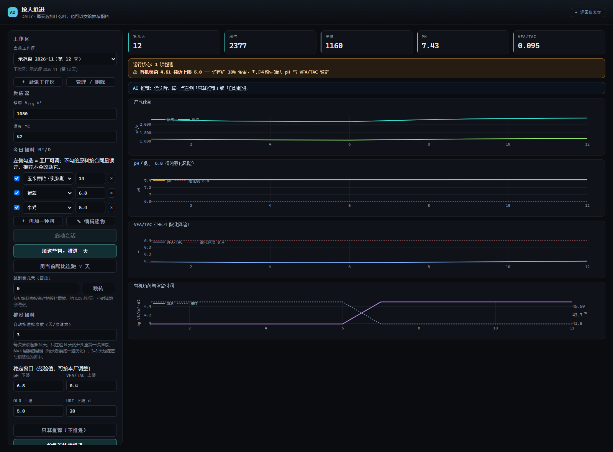
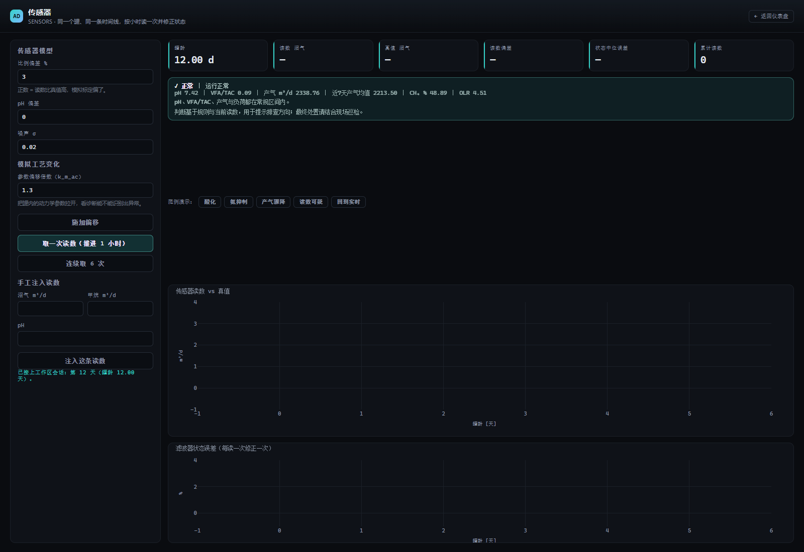

# PyADM1ODE 演示与运行环境

厌氧消化（ADM1da，41 状态）的可视化平台。**模型方程、组件库、配置器、基质数据全部来自上游
[PyADM1ODE](https://github.com/dgaida/PyADM1ODE)（MIT）**，本项目只改数值层、界面层和实验层。

---

## 启动

**第一次**：双击 `setup.bat`，建 Python 环境、装三个包、装 Julia（约 310 MB，10 分钟，
需要联网）。

**之后**：双击 `start.bat`，浏览器自动打开 <http://127.0.0.1:8848>。
`stop.bat` 停掉占端口的进程。

> 首次启动约 5 秒（Julia 在后台预热）；预热完成后点任何按钮都在 1 秒内出结果。
> 没有 Julia 也能跑，会自动退回 SciPy，只是慢一些。

目录约定：本文件旁边的 `../PyADM1ODE/` 就是源码仓库，`setup.bat` 在里面建 `.venv`。

---

## 页面

**演示部分**（看模型怎么算）

| 页面 | 地址 | 一句话 |
| --- | --- | --- |
| 仪表盘 | `/` | 调配料、改参数、跑仿真、看曲线，一键对比两个求解器 |
| 求解引擎 | `/engine` | 全屏视觉：画面上每一下跳动 = 求解器真实走的一步 |
| 三通道分步 | `/trace` | 三种积分器共用时间轴，步数差 3.5 倍、终值一致 |
| 组件系统 | `/system` | 两级厂站，物料 / 沼气 / 能量三条通道 |
| 参数标定 | `/calibration` | 给测量数据，反推动力学参数 |
| 状态估计 | `/estimation` | 只用气体产率和 pH，反推 41 个内部状态 |

**运行部分**（像工厂那样用）

| 页面 | 地址 | 一句话 |
| --- | --- | --- |
| 按天推进 | `/daily` | 每天加什么料、加多少；按推荐持续加；多方案对比；跳到第 N 天 |
| 传感器 | `/sensors` | 按小时读数并更正状态；自动诊断"现在正常吗、可能是什么问题、怎么办" |
| 底物库 | `/substrates` | 内置 13 种 + 自定义，按 TS / 蛋白 / 脂肪 / 纤维 / 灰分描述 |

### 按天推进

- 顶部选工作区（每个工作区记住自己的装置状态和曲线），没有就自动建一个
- 每种原料可以勾"可调/锁定"：**工厂控制不了的原料按合同量固定**，推荐只动可调的
- 「推荐加料」给出每料的当前 / 推荐 / 变化、预测甲烷、卡在哪条约束
- 四条曲线（产气、pH、VFA/TAC、负荷）在**同一坐标系**里叠多个方案，靠颜色区分
- 「跳到第 N 天」从初值按历史投料重放，约 0.05 秒/天

### 传感器与诊断

诊断按规则给出**结论 + 证据 + 动作**，并且先分清两类异常：

- **过程异常**：酸化、氨抑制、产气骤降、甲烷占比下降——罐子真出问题
- **仪表异常**：NIS 高说明读数与模型严重不符，这时先查表，别急着调料

---

## 可复现实验

`../experiments/` 里有参数筛选实验的脚本与结果：

- 12 个候选参数按敏感性排序，保留 `k_m_ac / k_m_pro / k_dis_PS`
- 标定后状态估计误差 MAE 15.42 vs 40.11（降低 61.6%），bootstrap 95% CI [+15.28, +34.02]
- 换随机种子复跑得 70.7%，结论稳定

---

## 便携包

不想装 Python / Julia，用 `PyADM1ODE-portable.zip`（约 110 MB，内置 CPython 3.12）：
解压后双击 `start.bat` 即可，不需要任何环境。
