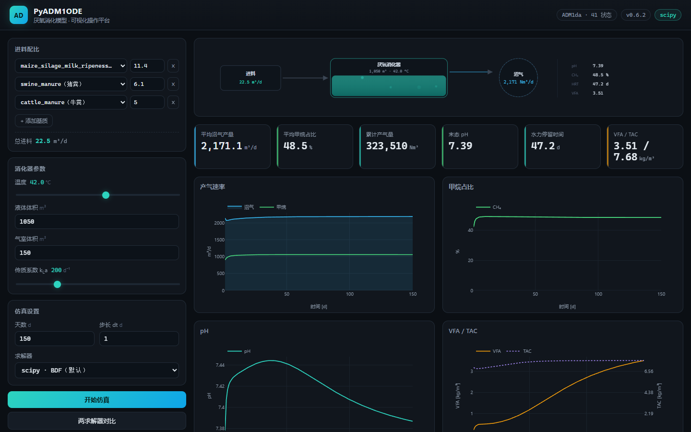
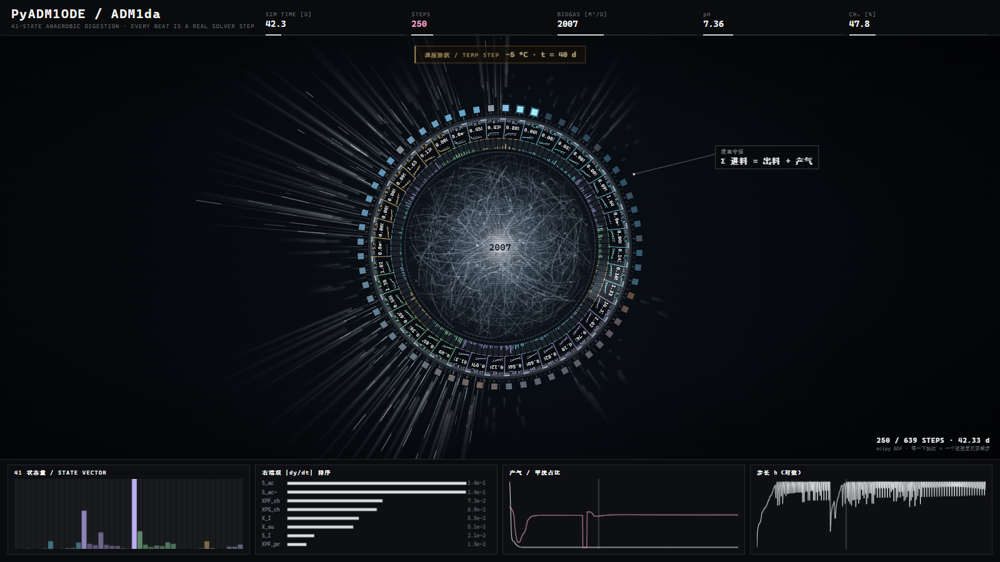
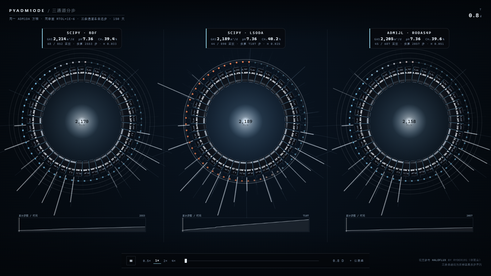

# PyADM1ODE 演示

厌氧消化（ADM1da，41 状态）的可视化演示：参数在页面上调、求解过程看得见、两条求解器并排比。

## 启动

双击 **`start.bat`**，浏览器会自动打开 <http://127.0.0.1:8848>。

关掉窗口即停止；或在别的窗口双击 `stop.bat`。

> 首次启动约 5 秒（Julia 在后台预热）。预热完成后点任何按钮都在 1 秒内出结果。

## 六个页面

| 页面 | 地址 | 一句话 |
| --- | --- | --- |
| 仪表盘 | `/` | 调配料、改参数、跑仿真、看曲线 |
| 求解引擎 | `/engine` | 全屏视觉：每一下跳动 = 求解器走的一步 |
| 三通道分步 | `/trace` | 三种积分器各跑一遍，共用时间轴对比 |
| 组件系统 | `/system` | 两级厂站，物料 / 沼气 / 能量三条通道 |
| 参数标定 | `/calibration` | 从数据反演一个动力学参数 |
| 状态估计 | `/estimation` | UKF 从产气/pH 反推内部状态 |

## 建议的演示顺序

1. **仪表盘** —— 改一下进料量，点「开始仿真」，曲线立刻变。再点「两求解器对比」。
2. **求解引擎** —— 讲"画面上每一下都是一个真实的求解步"，拖时间轴到第 40 天看温度阶跃。
3. **三通道分步** —— 同一个方程，三种积分器，步数差 3.5 倍，终值完全一致。
4. **参数标定 / 状态估计** —— 讲模型能反演什么、哪些量在短窗口内不可观测。

## 页面截图

## 几个数字（本机实测）

| 指标 | 值 |
| --- | --- |
| 150 天单消化器：scipy | 0.96 s |
| 同上：Julia / Rodas4P | 0.16 s（**5.8×**） |
| 两后端轨迹最大偏差 | 2.7 × 10⁻⁶ |
| 测试 | 862 passed |

## 数据说明

页面上的"实测数据"是**用模型自己生成的合成数据**（真值已知），用来演示标定与估计方法本身，不是真实厂站的测量记录。
